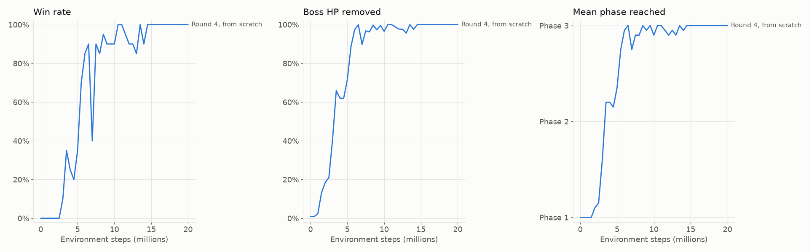

# Cuphead RL: beating Goopy Le Grande with sim-to-real reinforcement learning

A PPO agent that beats **Goopy Le Grande**, the first boss of Cuphead, playing as Mugman. It is
trained entirely in a custom Python simulator of the fight and then plays the real game through a
BepInEx mod, with no training on the real game.

| Final model (`r4_finetune`) | Wins | Hits taken per fight |
|---|---|---|
| Simulator, 100 held-out fights | 100 % | 0.39 |
| Real game, lockstep, 20 fights | **20 / 20** | 0.40 |
| Real game, paced (real-time speed, recorded), 10 fights | **10 / 10** | 0.70 |



## How it works

```
             spec.py: one observation / action / reward contract
       GameState -> 142-dim observation        MultiDiscrete (3,2,2,2,2,3)
              ^                                           |
              |                                           v
  sim/  (Python, 60 Hz, ~24k steps/s)          train/  (Stable-Baselines3 PPO)
              |                                           |
              v                                           v
  mod/  (C#, BepInEx 5 + Harmony, inside Cuphead) <-- TCP --> game/ (Gymnasium env)
```

* **Symbolic observation, not pixels.** Both backends produce the same `GameState`: player,
  boss (move, timing, phase) and the 8 nearest hazards, encoded as 142 numbers. A policy trained in
  one runs in the other unchanged.
* **Simulator calibrated to the game.** Constants come from the decompiled `LevelProperties.Slime`
  and player motor; animated hitboxes were sampled live from the running game and replayed in the
  sim. Recorded game traces are compared against the sim (`scripts/compare_traces.py`).
* **Real-game bridge.** A Harmony-patched plugin reads the fight state, drives input through a
  Rewired patch and talks newline-delimited JSON over a local socket. In **lockstep** mode the game
  advances exactly the requested ticks (`captureFramerate`), so it behaves like the simulator.
* **Training.** PPO with a 6-head factored action space (move, jump, dash, shoot, EX, vertical aim),
  a reverse phase curriculum (start at the last phase, move back as win rate passes 60 %) and
  ±15 % physics domain randomization. CPU only, small MLPs (256×256).

## The interesting part: closing the sim-to-real gap

The learning recipe barely changed after the second round. Most of the progress came from finding
where the simulator and the game disagreed, by logging **why** every hit happened in both worlds
and comparing cause by cause.

| Finding | Effect |
|---|---|
| The tombstone's hurtbox is high up; straight shots do no damage | Added a vertical-aim action head; without it the fight was unwinnable |
| Goopy's punch-position rule was mirrored in the sim | Plain PPO plateaued at 0 % wins; fixed, the same recipe reached 100 % in the sim |
| The plugin averaged velocities over 4 ticks in lockstep | Same model, no retraining: 83 % → 95 % real-game wins |
| The sim reported zero body velocity during the punch animation | The policy uses that velocity to decide when to duck (P(duck) 1.00 → 0.28 without it) |
| Held-jump gravity tick, tombstone damage window, EX lockout | After these, sim and game agreed: 0.81 vs 0.80 hits per fight |

Details, numbers and the full experiment history: [`docs/RESEARCH_LOG.md`](docs/RESEARCH_LOG.md),
[`docs/SIM_VS_GAME.md`](docs/SIM_VS_GAME.md), [`docs/GAME_BRIDGE.md`](docs/GAME_BRIDGE.md),
[`docs/GAME_CONSTANTS.md`](docs/GAME_CONSTANTS.md).

## Repository layout

| Path | Contents |
|---|---|
| `src/cuphead_rl/spec.py` | The shared contract: state types, observation encoder, action decoder, reward |
| `src/cuphead_rl/sim/` | Simulator (`world.py`, `player.py`, `goopy.py`), Gymnasium env, 1930s-style renderer and video recorder |
| `src/cuphead_rl/train/` | Configs, vectorized envs, curriculum, PPO training with resume and fine-tuning, evaluation, plots |
| `src/cuphead_rl/game/` | TCP client and Gymnasium env for the real game, screen capture |
| `mod/CupheadRLBridge/` | The BepInEx plugin: state reader, input override, lockstep server, save guard |
| `configs/` | Experiment configs for every round |
| `scripts/` | Real-game evaluation and recording, hit-cause analysis, trace comparison, highlight reels |
| `tools/` | Mod install, bridge verification, hitbox sampling, trace recording, save checks |
| `data/` | Game constants, recorded traces, evaluation results |
| `tests/` | Simulator mechanics, calibration, spec, training pipeline, bridge client |

## Quickstart

Requires Python 3.12 and [uv](https://docs.astral.sh/uv/).

```powershell
python -m uv sync
python -m uv run pytest

# Train (writes runs/<name>/: metrics, checkpoints, milestone videos)
python -m uv run python -m cuphead_rl.train.train configs/r4_scratch.yaml
python -m uv run python -m cuphead_rl.train.train --resume runs/r4_scratch

# Evaluate on 100 held-out seeds, optionally with randomized physics or a video
python -m uv run python -m cuphead_rl.train.evaluate runs/r4_scratch/final.zip --episodes 100 --seed 20000
python -m uv run python -m cuphead_rl.train.evaluate runs/r4_scratch/final.zip --episodes 1 --video videos/fight.mp4

# Learning curves
python -m uv run python -m cuphead_rl.train.plots runs/r4_scratch -o curves.png
```

### Playing the real game

Requires your own copy of Cuphead (Steam, Windows). `tools/install_bepinex.ps1 -Game <Cuphead folder>`
installs BepInEx 5 (adding files only); building and installing the plugin, and the evaluation
protocol, are in [`docs/GAME_BRIDGE.md`](docs/GAME_BRIDGE.md).

```powershell
python tools/check_saves.py --out data/save_safety/before.json        # game closed
python -m uv run python scripts/play_game.py runs/r4_finetune/final.zip --episodes 20
python -m uv run python scripts/play_game.py runs/r4_finetune/final.zip --episodes 5 --record videos/game
python -m uv run python scripts/overlay_game_video.py videos/game/episode_00.mp4
python tools/check_saves.py --assert-unchanged data/save_safety/before.json
```

**Your save files are protected.** While the plugin is loaded, a fail-closed save guard lets the
game write only to save slot 3. Every other slot write is dropped, and if any guard fails to
install, the plugin refuses to start. Still, back up `%APPDATA%\Cuphead` before using the mod.

## Notes

* The simulator and the game bridge were developed with the help of AI coding agents.
* MIT licensed (see `LICENSE`). Fan project for research and education. Not affiliated with or endorsed by Studio MDHR. No game
  code or assets are included; the mod reads the game you own at runtime.
