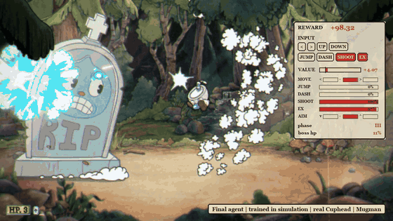
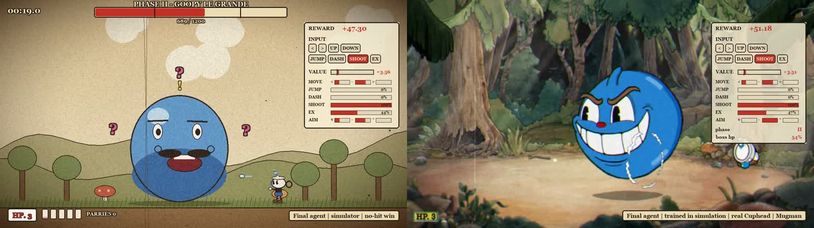
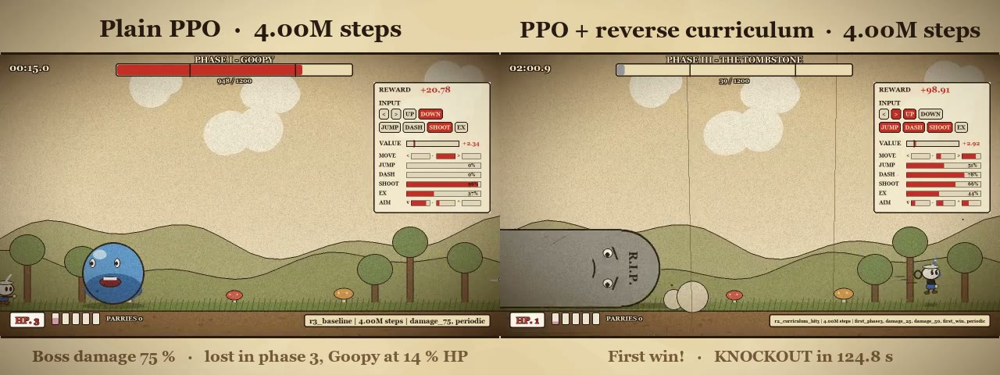
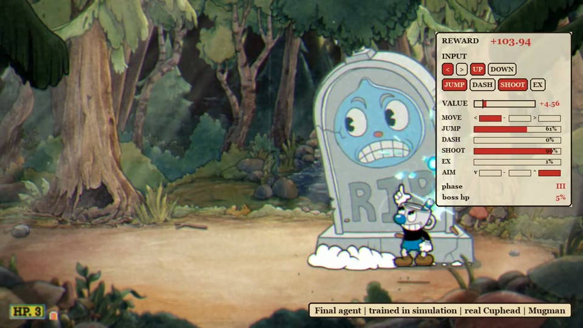

<div align="center">

# Cuphead RL

**A reinforcement learning agent that beats Goopy Le Grande in Cuphead.**<br>
Trained entirely in a custom simulator, then played in the real game with no extra training.

[](https://www.python.org/)
[](https://github.com/DLR-RM/stable-baselines3)
[](https://github.com/BepInEx/BepInEx)
[](LICENSE)



*The final agent in the real game: it aims up at the tombstone and wins without taking a hit.*

</div>

## Results

| Final model (`r4_finetune`) | Wins | Hits taken per fight |
|---|---|---|
| Simulator, 100 held-out fights | 100 % | 0.39 |
| Real game, lockstep, 20 fights | **20 / 20** | 0.40 |
| Real game, paced (real-time speed, recorded), 10 fights | **10 / 10** | 0.70 |

12 of the 20 lockstep fights were won without taking a hit. The trained model is available in the
[v1.0 release](https://github.com/Deinigu/cuphead-rl/releases/tag/v1.0).

## Contents

- [Highlights](#highlights)
- [How it works](#how-it-works)
- [Closing the sim-to-real gap](#closing-the-sim-to-real-gap)
- [Getting started](#getting-started)
- [Repository layout](#repository-layout)
- [Documentation](#documentation)
- [Acknowledgements and license](#acknowledgements-and-license)

## Highlights

- **Sim-to-real transfer.** The policy never trains on the real game. Simulator and game produce the
  same 142-number observation, so the same network runs in both unchanged.
- **Simulator calibrated to the game**, ~24,000 steps/s per CPU core (about 400× real time). Constants
  come from the game's decompiled code; animated hitboxes were sampled live from the running game.
- **Real-game bridge.** A C# BepInEx/Harmony mod reads the fight, drives input and runs the game in
  lockstep with the agent over a local socket.
- **Save-safe by design.** A fail-closed guard lets the game write only to save slot 3.
- **CPU only.** Small MLPs (256×256), PPO with a factored action space, a reverse phase curriculum
  and ±15 % physics randomization.

<p align="center">
  <br>
  <em>Same agent, same observation: the simulator (left) and the real game (right). The panel shows the
  value estimate and the probability of every button.</em>
</p>

## How it works

```
             spec.py: one observation / action / reward contract
       GameState -> 142-dim observation        MultiDiscrete (3,2,2,2,2,3)
              ^                                           |
              |                                           v
  sim/  (Python, 60 Hz, ~24k steps/s)          train/  (Stable-Baselines3 PPO)
              |                                           |
              v                                           v
  mod/  (C#, BepInEx 5 + Harmony, inside Cuphead) <-- TCP --> game/ (Gymnasium env)
```

- **Observation, not pixels.** Both backends produce the same `GameState`: player, boss (move,
  timing, phase) and the 8 nearest hazards, encoded as 142 numbers.
- **Actions.** Six heads chosen together, 15 times a second: move, jump, dash, shoot, EX and vertical
  aim.
- **Reward.** Damage dealt to the boss, a penalty per hit taken and a large bonus for winning.
- **Simulator.** Constants from the decompiled `LevelProperties.Slime` and player motor; recorded
  game traces are compared against the sim (`scripts/compare_traces.py`).
- **Bridge.** A Harmony-patched plugin reads the fight state, drives input through a Rewired patch
  and talks newline-delimited JSON over a local socket. In **lockstep** mode the game advances
  exactly the requested ticks (`captureFramerate`), so it behaves like the simulator.
- **Training.** A reverse phase curriculum starts at the last phase and moves back once the win
  rate passes 60 %. Plain PPO learns faster at first but plateaus at 94 % with about six times as
  many hits.

<p align="center">
  <br>
  <em>After 4M steps: plain PPO is still losing in phase 3, while the curriculum agent gets its first win.</em>
</p>

## Closing the sim-to-real gap

The learning recipe barely changed after the second round. Most of the progress came from finding
where the simulator and the game disagreed, by logging **why** every hit happened in both worlds
and comparing cause by cause.

| Finding | Effect |
|---|---|
| The tombstone's hurtbox is high up; straight shots do no damage | Added a vertical-aim action head; without it the fight was unwinnable |
| Goopy's punch-position rule was mirrored in the sim | Plain PPO plateaued at 0 % wins; fixed, the same recipe reached 100 % in the sim |
| The plugin averaged velocities over 4 ticks in lockstep | Same model, no retraining: 83 % → 95 % real-game wins |
| The sim reported zero body velocity during the punch animation | The policy uses that velocity to decide when to duck (P(duck) 1.00 → 0.28 without it) |
| Held-jump gravity tick, tombstone damage window, EX lockout | After these, sim and game agreed: 0.81 vs 0.80 hits per fight |

<p align="center">
  <br>
  <em>Nobody told it how to beat the tombstone: it learned to stand next to it, aim up and shoot.</em>
</p>


## Getting started

### Requirements

- Python 3.12 and [uv](https://docs.astral.sh/uv/)
- For the real game only: Windows and your own copy of Cuphead (Steam), plus ffmpeg for recording

### Install and test

```powershell
git clone https://github.com/Deinigu/cuphead-rl.git
cd cuphead-rl
python -m uv sync
python -m uv run pytest
```

### Train and evaluate in the simulator

```powershell
# Train (writes runs/<name>/: metrics, checkpoints, milestone videos)
python -m uv run python -m cuphead_rl.train.train configs/r4_scratch.yaml
python -m uv run python -m cuphead_rl.train.train --resume runs/r4_scratch

# Evaluate on 100 held-out seeds, optionally with a video
python -m uv run python -m cuphead_rl.train.evaluate runs/r4_scratch/final.zip --episodes 100 --seed 20000
python -m uv run python -m cuphead_rl.train.evaluate runs/r4_scratch/final.zip --episodes 1 --video videos/fight.mp4

# Learning curves
python -m uv run python -m cuphead_rl.train.plots runs/r4_scratch -o curves.png
```

To skip training, download `final.zip` from the [v1.0 release](https://github.com/Deinigu/cuphead-rl/releases/tag/v1.0)
and put it at `runs/r4_finetune/final.zip`.

### Play the real game

> [!WARNING]
> Back up `%APPDATA%\Cuphead` before using the mod. While the plugin is loaded, a fail-closed save
> guard lets the game write only to save slot 3; every other slot write is dropped, and if any guard
> fails to install, the plugin refuses to start.

`tools/install_bepinex.ps1 -Game <Cuphead folder>` installs BepInEx 5 (adding files only). Building
and installing the plugin, and the evaluation protocol, are in [`docs/GAME_BRIDGE.md`](docs/GAME_BRIDGE.md).

```powershell
python tools/check_saves.py --out data/save_safety/before.json        # game closed
python -m uv run python scripts/play_game.py runs/r4_finetune/final.zip --episodes 20
python -m uv run python scripts/play_game.py runs/r4_finetune/final.zip --episodes 5 --record videos/game
python -m uv run python scripts/overlay_game_video.py videos/game/episode_00.mp4
python tools/check_saves.py --assert-unchanged data/save_safety/before.json
```

Recordings run at real speed with the game audio, from the intro to the knockout (or death) and
results screen.

## Repository layout

| Path | Contents |
|---|---|
| `src/cuphead_rl/spec.py` | The shared contract: state types, observation encoder, action decoder, reward |
| `src/cuphead_rl/sim/` | Simulator (`world.py`, `player.py`, `goopy.py`), Gymnasium env, 1930s-style renderer and video recorder |
| `src/cuphead_rl/train/` | Configs, vectorized envs, curriculum, PPO training with resume and fine-tuning, evaluation, plots |
| `src/cuphead_rl/game/` | TCP client and Gymnasium env for the real game, screen and audio capture |
| `mod/CupheadRLBridge/` | The BepInEx plugin: state reader, input override, lockstep server, save guard |
| `configs/` | Experiment configs for every round |
| `scripts/` | Real-game evaluation and recording, hit-cause analysis, trace comparison, highlight reels |
| `tools/` | Mod install, bridge verification, hitbox sampling, trace recording, save checks |
| `data/` | Game constants, recorded traces, evaluation results |
| `tests/` | Simulator mechanics, calibration, spec, training pipeline, bridge client, capture |

## Documentation

| Document | What's in it |
|---|---|
| [`docs/RESEARCH_LOG.md`](docs/RESEARCH_LOG.md) | Every experiment, round by round, with numbers |
| [`docs/SIM_VS_GAME.md`](docs/SIM_VS_GAME.md) | How the simulator was checked against the real game |
| [`docs/GAME_BRIDGE.md`](docs/GAME_BRIDGE.md) | The mod, lockstep/paced/free modes, recording and the evaluation protocol |
| [`docs/GAME_CONSTANTS.md`](docs/GAME_CONSTANTS.md) | Constants extracted from the game |

## Acknowledgements and license

- The simulator and the game bridge were developed with the help of AI coding agents.
- Built with [Stable-Baselines3](https://github.com/DLR-RM/stable-baselines3),
  [Gymnasium](https://gymnasium.farama.org/), [BepInEx](https://github.com/BepInEx/BepInEx) and
  [Harmony](https://github.com/pardeike/Harmony).
- Released under the [MIT License](LICENSE).

Fan project for research and education. Not affiliated with or endorsed by Studio MDHR. No game code
or assets are included; the mod reads the game you own at runtime. Screenshots of Cuphead © Studio MDHR.
