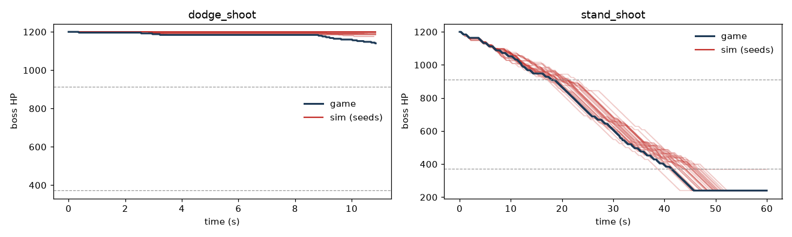

# Sim vs game

Generated by `scripts/compare_traces.py`: the recorded real-game action sequence of each trace is replayed in the simulator from 30 seeds (mean ± std); the same statistics are computed from both. Gap = |sim − game| / |game|; n = number of game events behind the game value (n = 1: a single sample, read the sim std before the gap). Rows sorted by gap.

## dodge_shoot

policy `dodge_shoot`, 652 ticks, no_hit=False, seed 2026

The recorded policy reacts to the boss and the player can be hit, so the open-loop replay drifts from the game run: damage/phase statistics are listed but left out of the largest gaps.

| statistic | game | n | sim | gap |
|---|---|---|---|---|
| dps.small | 5.53 | 1 | 0.62 ± 0.64 | 89 % |
| small.punch_windup_first_s | 1.07 | 1 | 1.25 ± 0.19 | 17 % |
| small.hop_dx | 391 | 7 | 445 ± 35 | 14 % |
| final_hp | 1.14e+03 | 1 | 1.19e+03 ± 7 | 5 % |
| first_takeoff_s | 0.717 | 1 | 0.747 ± 0.09 | 4 % |
| small.hop_airtime_s | 0.633 | 7 | 0.646 ± 0.011 | 2 % |
| small.hop_period_s | 1.2 | 6 | 1.21 ± 0.011 | 1 % |
| episode_s | 10.9 | 1 | 10.8 ± 0.16 | 1 % |
| small.hop_apex_max | 405 | 1 | 405 ± 1.1e-13 | 0 % |
| small.hop_apex_min | 291 | 1 | 291 ± 5.7e-14 | 0 % |
| small.ground_time_s | 0.567 | 6 | 0.567 ± 0 | 0 % |
| small.punch_s | 0.517 | 1 | 0.517 ± 0 | 0 % |
| small.punch_to_jump_s | — | — | 1.28 ± 0 | — |

## stand_shoot

policy `stand_shoot`, 3600 ticks, no_hit=True, seed 2026

| statistic | game | n | sim | gap |
|---|---|---|---|---|
| phase1.until_transform_s | 18.7 | 1 | 21.9 ± 2 | 17 % |
| tomb.smash_period_s | 4.12 | 1 | 4.78 ± 0.87 | 16 % |
| dps.tomb | 0.553 | 1 | 0.634 ± 0.2 | 15 % |
| small.punch_windup_first_s | 1.45 | 1 | 1.34 ± 0.18 | 8 % |
| transform.tomb_drop_s | 0.217 | 1 | 0.2 ± 5.6e-17 | 8 % |
| big.punch_s | 0.7 | 1 | 0.651 ± 0.095 | 7 % |
| dps.small | 19.5 | 1 | 18.4 ± 1.1 | 6 % |
| dps.big | 22.7 | 1 | 21.5 ± 1.7 | 5 % |
| first_takeoff_s | 0.717 | 1 | 0.747 ± 0.09 | 4 % |
| big.punch_windup_first_s | 2.15 | 1 | 2.07 ± 0.091 | 4 % |
| small.punch_to_jump_s | 1.27 | 1 | 1.31 ± 0.071 | 4 % |
| phase1.hp_at_transform | 904 | 1 | 874 ± 23 | 3 % |
| transform.death_hp_lost | 120 | 1 | 117 ± 22 | 3 % |
| phase2.duration_s | 16.2 | 1 | 15.8 ± 1.3 | 3 % |
| tomb.wall_to_wall_s | 1.4 | 6 | 1.44 ± 0.22 | 3 % |
| small.hop_dx | 451 | 13 | 441 ± 28 | 2 % |
| big.hop_airtime_s | 0.65 | 10 | 0.663 ± 0.015 | 2 % |
| big.hop_dx | 443 | 10 | 435 ± 50 | 2 % |
| final_hp | 240 | 1 | 244 ± 23 | 2 % |
| tomb.land_to_first_smash_s | 4.57 | 1 | 4.5 ± 0.79 | 1 % |
| big.hop_period_s | 1.25 | 8 | 1.26 ± 0.015 | 1 % |
| small.hop_airtime_s | 0.654 | 13 | 0.648 ± 0.0073 | 1 % |
| transform.death_to_tomb_s | 4.08 | 1 | 4.12 ± 1.8e-15 | 1 % |
| big.punch_to_jump_s | 1.77 | 1 | 1.78 ± 0.05 | 1 % |
| small.hop_period_s | 1.22 | 11 | 1.21 ± 0.0073 | 0 % |
| transform.small_to_big_s | 6.5 | 1 | 6.52 ± 2.7e-15 | 0 % |
| transform.small_to_big_hp_lost | 196 | 1 | 196 ± 1 | 0 % |
| small.hop_apex_max | 405 | 1 | 405 ± 1.1e-13 | 0 % |
| big.hop_apex_max | 518 | 1 | 518 ± 1.1e-13 | 0 % |
| small.punch_s | 0.517 | 1 | 0.517 ± 2.2e-16 | 0 % |
| small.hop_apex_min | 291 | 1 | 291 ± 5.7e-14 | 0 % |
| big.ground_time_s | 0.6 | 8 | 0.6 ± 1.1e-16 | 0 % |
| tomb.smash_s | 1.27 | 2 | 1.27 ± 2.2e-16 | 0 % |
| big.hop_apex_min | 319 | 1 | 319 ± 0 | 0 % |
| episode_s | 60 | 1 | 60 ± 0 | 0 % |
| small.ground_time_s | 0.567 | 11 | 0.567 ± 0 | 0 % |
| big.punch_windup_later_s | — | — | 1.17 ± 0.064 | — |
| small.punch_windup_later_s | — | — | 1.35 ± 0.17 | — |

## Largest gaps

* `stand_shoot` phase1.until_transform_s: game 18.7, sim 21.9 (17 %)
* `dodge_shoot` small.punch_windup_first_s: game 1.07, sim 1.25 (17 %)
* `stand_shoot` tomb.smash_period_s: game 4.12, sim 4.78 (16 %)
* `stand_shoot` dps.tomb: game 0.553, sim 0.634 (15 %)
* `dodge_shoot` small.hop_dx: game 391, sim 445 (14 %)
* `stand_shoot` small.punch_windup_first_s: game 1.45, sim 1.34 (8 %)
* `stand_shoot` transform.tomb_drop_s: game 0.217, sim 0.2 (8 %)
* `stand_shoot` big.punch_s: game 0.7, sim 0.651 (7 %)
* `stand_shoot` dps.small: game 19.5, sim 18.4 (6 %)
* `stand_shoot` dps.big: game 22.7, sim 21.5 (5 %)

<!-- hand-written notes below this line are kept when the report is regenerated -->

## What changed in the sim (first traces)

Rule source: the decompiled `SlimeLevelSlime` / `SlimeLevelTombstone` / `SlimeLevel`, with
animation lengths read off the `stand_shoot` trace (per-tick `boss.anim`).

| fix | cause in the game | stat before → after (stand_shoot, game value) |
|---|---|---|
| Goopy takes damage while transforming (one HP pool, no cap) | every collider hit goes through `DealDamage`; the small slime's collider stays on until `TurnBig` enables big Goopy's | small→big HP lost 0.4 → 197 (196); final HP 361 → 240 (240) |
| Transformation 6.5 s with the body growing at ticks 253–290, ? marks on 151–370 | `small_slime_transform` anim | small→big 2.52 → 6.52 s (6.5) |
| Phase = visible entity: BIG during the death anim, TOMB when the tombstone appears | spec d435b30 | tomb drop 4.32 → 0.2 s (0.217) |
| Landing squish anims added to every ground stay (22 / 18 ticks) | `jump_cr` waits for `Jump_Squish_Loop` before the delay and for `Up` after it | ground time small 0.217 → 0.567 s (0.567), big 0.3 → 0.6 s (0.6); hop period 0.86 → 1.21 s (1.19) |
| `D<x>` pattern delays apply before the following jump; every punch restarts `jump_cr` (random pattern index, default delay) | `jump_cr` | — |
| Intro 1.0 → 10/60 s | `IntroContinue` starts `jump_cr` at once; `first_pattern_delay` only delays `slimePattern_cr` | first take-off tick 73 → 44 (43) |
| Punch_End counts as idle; big Punch_End is 28 ticks | `punch_cr` calls `StartJump` when `Punch_End` starts | small punch 0.717 → 0.517 s (0.517); punch→jump big 1.23 → 1.77 s (1.77), small 0.95 → 1.31 s (1.44) |
| Only big Goopy's first punch plays the 64-tick blink windup; its first punch ignores the punch position | `FirstPunch` anim bool; `jumpsBeforeFirstPunch` path skips `inPunchPosition` | big later windup 1.97 → 1.2 s (no clean game sample yet) |
| Small turn-punch: +23 ticks with no collider (invulnerable, harmless) | `Punch_Start_Turn` anim | small later windup 1.07 → 1.35 s (1.45) |
| Big Goopy dies at once when hit below 31 % on the ground, even mid-punch | `DeathTransform` → `Die` stops all coroutines unless airborne | phase 2 now ends mid-windup as in the trace (tick 2680) |
| Tombstone: smash decided only between legs; random first direction; pauses before each leg (land 125, start 10, turn 20 ticks); circle leans 40 forward while sliding; random offset start | `move_cr` `while (!wantsToSmash)` loop, `WaitForAnimationToStart(Move_*)` | wall-to-wall 1.07 → 1.38 s (1.4) |
| Tombstone invulnerable 22 ticks while underground in the smash | `DisableDamageReceiver` anim event (trace: `vulnerable` false) | — |
| Shots hit big Goopy while the tombstone drops (until it is crushed) | big Goopy's collider stays until `Explode` | tomb-phase DPS 0 → 0.74 (0.71) |

Heuristic policy (50 episodes, seeds 0–49): 72 % wins before and after; mean episode
86.9 s → 57.6 s (Goopy now loses HP while transforming).

## Review fixes and re-recorded traces

Traces: `data/traces/` (re-recorded with the fixed hazard classification).
The table above quotes the first traces.

| fix | cause in the game | effect |
|---|---|---|
| Punch position was mirrored: now right inside (min, max), left inside (−max, −min) | `inPunchPosition` | both small punches of the new traces (stand_shoot tick 631: Goopy 393, player −410; dodge_shoot tick 547: Goopy −560, player −462) were impossible in the sim before |
| The punch is decided once, on the landing frame, and starts after `punch_delay` | `jump_cr`: `numJumpsLeft <= 0 && inPunchPosition()` at the landing; `Punch()` picks the side then | the player crossing sides while Goopy stands no longer triggers a punch |
| Big turn-punches: +11 windup ticks, body stays hittable; later big punches skip 57 blink ticks (non-turn Punch_Start 7 ticks: est) | trace: `Punch_Blink_Start_Turn` 75 vs `Punch_Blink_Start` 64; later `Punch_Start_Turn` 18 | big first windup 1.97 → 2.07 s (game 2.15, a turning punch = 2.15 in the sim) |
| Random pattern start drawn over the raw tokens (D included); starting right after a D skips its delay | `Random.Range(0, pattern.Length)` | first take-off is 0.717 s, or 1.2 s when a D.5 is drawn |
| Sim rows recorded after the step, as `tools/record_trace.py` does | — | removes a 1-tick offset on absolute times; `intro_time` = 10/60 s still matches (first take-off row 43 in both) |
| State export recomputes the body when a hit ends a punch that step; randomization scales the growth/question-mark timeline with `grow_time`; the heuristic plans against every windup variant and uses the fixed punch rule | review | — |

Gap table on the new traces, `stand_shoot`, before (517df2b) → after: big.punch_windup_first
1.97 → 2.07 s (2.15), tomb.smash_period 4.72 → 4.78 s (4.12, n = 1), phase1.until_transform
21.5 → 21.9 s (18.7, n = 1), dps.tomb 0.74 → 0.63 (0.55). Every multi-sample statistic is
within 3 % (stand_shoot) and 14 % (dodge_shoot hop_dx, an open-loop replay).

Heuristic policy (50 episodes, seeds 0–49): 72 % → **92 %** wins, mean episode 57.6 → 66.9 s.
With the mirrored rule Goopy punched from positions the game never punches from.

## Remaining gaps

* **phase1.until_transform** 18.7 vs 21.9 ± 2.0 s (n = 1, 1.6 σ): Goopy only transforms on a
  landing with |x| < 350 after HP < 76 %, so the time is set by where it lands. The sim also
  deals about 6 % less damage in phase 1 (18.4 vs 19.5 DPS). The cause isn't clear yet.
* **Tomb smash timing** (n = 1 each): the game values (first smash 4.57 s, period 4.12 s) are
  inside the sim's spread on these traces. The first traces had 3.38 s and 7.1 s, at the 5th
  and 99th percentiles.
* **small.punch_windup_first**: the sim mixes turn and non-turn punches (the first punch is
  a turn in stand_shoot, 1.45 s, and not in dodge_shoot, 1.07 s; both match the sim's two
  variants exactly).
* **tomb_drop** 1 tick: the tween ends a tick later in the game.
* `dodge_shoot` reacts to the boss; its open-loop replay drifts (hop_dx +14 %, damage not
  comparable).

## Phase-I punch lunge: why the game hits and the sim doesn't

Real-game result (docs/GAME_BRIDGE.md): `r2_curriculum_hit3` is hit by small Goopy's punch lunge
0.75 times per fight in lockstep and 0.30 paced, against 0.04 in the sim. Data: the bridge logs in
the logged lockstep and paced runs, and 100 sim fights (seeds
10000–10099, same deterministic policy) logged with the same compact state.

**The punch itself matches.** Windup is 64 ticks (16 decisions), plus 23 hidden ticks when
Goopy turns (22 decisions). The windup body is at dx −110, y 23, r 120, and the r 170 lunge
circle appears at track tick 69, 4 ticks after the first `PUNCH` observation. All of this is
identical in the logs of both worlds. Where the punch happens matches too: the player is
372 (sim) / 370 (lockstep) / 366 (paced) units ahead of Goopy at the windup start, turn punches
are 66 % / 52 % / 60 % of all punches, and the agent stands still through 82–95 % of the
windup in all three. The player is inside the lunge's reach in 98 % of sim punches. It just
doesn't get hit.

**What differs is one decision.** The policy dodges by ducking on the first decision after
`PUNCH` appears. The duck hurtbox (top at y 42.5) passes 0.5 units under the r 170 circle
(bottom at y 43). In the sim it does this every time: P(duck) is 1.00 in all 101 punches. In the
game the decision splits:

| first decision after `PUNCH` | lockstep punches | hit | paced punches | hit |
|---|---|---|---|---|
| P(duck) < 0.5: stands, ducks 4 ticks late | 12 | **12** | 3 | **3** |
| P(duck) ≥ 0.5: ducks in time | 11 | 3 | 7 | 0 |

The 3 lockstep hits after an early duck are: one where the player was still in the air from a
jump during the windup, one at 222 units where the arm box reaches the ground, and one where
the sim's geometry says the duck clears by 1.3 units (not explained).

**Why the decision flips: the boss velocity.** I took the sim's observation at the first
`PUNCH` frame (40 punches) and made one feature at a time game-like:

| change | mean P(duck) | P(duck) < 0.5 |
|---|---|---|
| none (sim) | 0.999 | 0 % |
| lunge hazard kind `FIST` → `BODY` (the bridge's label) | 0.986 | 0 % |
| boss `state_time` → 0 (the bridge starts it a tick later) | 0.999 | 0 % |
| boss and body-hazard velocity → 4-tick difference of the collider centre, as the bridge reports it | **0.282** | **72 %** |

The sim reported **zero** velocity for the boss and its body hazard while a live track plays
(`vx`/`vy` are the jump velocity; tracks move the hitbox frame by frame). The tombstone smash
hazard was also zero, and the punch arm boxes had vy = 0. The game's collider really moves:
80 u/tick at tick 65, the first `PUNCH` frame. So the game shows 1350–3150 u/s (4-tick
differences in lockstep) where the sim showed 0, and once the bridge moves to per-tick
differences it will show 4800 u/s. The policy has never seen a fast-moving body there, and
in most cases it stops ducking. This is a sim bug separate from the bridge's 4-tick velocity
issue.

**Fix** (`goopy.py` `Goopy.velocity`, used for `BossInfo` and the body/`TOMB` hazards): while a
track plays, the velocity is the per-tick difference of the body centre. It is 0 when a
collider switches on and above 6000 u/s, the bridge's teleport rule (`StateReader.MaxSpeed`),
so the 290-unit jump of the lunge itself reads 0 in both worlds. Arm boxes get vy too. The test
is `test_punch_track_reports_the_body_velocity_the_game_shows`. Dynamics don't change:
`compare_traces.py --seeds 30` reproduces this report and its figure byte-for-byte, and
`calibrate_sim.py` passes.

**With the fix, the sim reproduces the gap.** The same policy over the same 100 fights is now
hit by 39 of 101 phase-I punches (0.39 per fight, was 0.02). Hits per fight go from 0.11 to
0.48, and the phase II/III causes are unchanged (BODY 4 → 3, TOMB 4 → 5, transform 1 → 1). The
policy has to be retrained, or fine-tuned, on the fixed sim to learn the lunge with real
velocities. The duck dodge itself is fragile: 0.5 units of clearance. A policy that steps out of
the 226–554 reach band instead of ducking under the circle would be more robust in the game.

## Last check before round 4: jump, tombstone slam, EX

Data: the plugin's per-tick velocity check (`data/check_velocities_after.json`), the `dodge_shoot` /
`stand_shoot` traces, the per-tick lockstep logs (20 fights)
and 100 sim fights of `r2_curriculum_hit3` (seeds 10000–10099) logged the same way. Decompiled
source: the decompiled `LevelPlayerMotor`.

**1. Jump: real motion, not only the report.** With jump held the game rises 18.72 u per tick
(74.886 over the first 4 ticks), i.e. 1123.2 u/s. That is `jump_speed` minus one tick of
gravity: `HandleJumping` resets the normalised vy, then `HandleFalling` still applies gravity in
the same tick. The sim held 1223.1 with no gravity, so every jump flew 9 × 99.86/60 = 15 u too
high. The trace showed it as a constant +14.98 from tick 40 on, the "apex 298 vs 283" noted in
RESEARCH_LOG.

Now each jumping tick resets vy, then decides whether the next tick still jumps, and gravity
always applies. The result:
- a one-tick tap holds 2 ticks, apex **133.52**: the `dodge_shoot` tap jumps rise 18.7, 18.7,
  17.1 u per tick to 133.52;
- a full hold lasts 10 ticks, apex **283.28** (game 283.3), airtime 0.667 s;
- the recorded jump arc matches tick for tick within 0.004 u, positions and velocities alike.

The heuristic's own player model uses the held rise speed too. The test is
`test_held_jump_rises_at_jump_speed_minus_one_tick_of_gravity`, and the tap and full-hold
tolerances are now ±0.1.

**2. Tombstone slam.** Two real mismatches, and the policy behaves the same once they are fixed.
- *Damage window.* In both `stand_shoot` smashes the `TOMB` hazard (`dealDamage`) is on from
  **40 to 57** ticks after the anticipation starts. The sim used the radius (r ≥ 101), which gave
  ticks 37–59: 3 ticks early, and tick 39 (cy 256, r 201) already reached the ground. It is now
  `tomb.smash_damage_ticks = (40, 58)`, tested against the trace. In the logs, damage now first
  shows 3–4 decisions after the windup in the sim, the same as the game (it was 2–3).
- *First-frame velocity.* The bridge samples the `TOMB` collider only while it deals damage, so
  its first damage frame reads v = 0. The sim now does the same.
- *Positions and move timing* match: windup 7–8 decisions in both, the same smash track, and the
  agent dashes out to about 490 (game) / 570 (sim) units on slams it survives.

**What decides a slam is an EX lockout.** Split by whether an EX freeze overlaps the slam:

| slams | game (34) | sim before (160) | sim after (182) |
|---|---|---|---|
| no EX freeze during the slam: hit | 1/30 | 3/156 | 4/180 |
| EX freeze during the slam: hit | **4/4** | **0/4** | **2/2** |

**3. EX lockout (`LevelPlayerMotor.StartEx` / `exMove_cr`).** The EX turns input and gravity off
until the animation ends. At `OnExFired` the shot leaves, and unless the pose is straight up or
down the player is pushed back at `exKnockback` = **230 u/s**. In every lockstep EX where the
player was walking (so its start is visible; 20+ cases): frozen for 15 ticks after the press tick, then 18 ticks of
sliding back (15.3 u per decision, whatever the input), then control returns. Dash and jump
presses do nothing for the whole time. The sim had a 0.3 s (18-tick) freeze, an estimate, with
the shot leaving at once and no slide, so its agent always had time to dash out.

Now `ex_freeze` = 16/60 (press tick included), `ex_knockback_time` = 18/60 and
`ex_knockback` = 230. Straight up/down EXs freeze without sliding, the shot leaves at the end
of the freeze, and a hit before then cancels it. The one remaining difference: the game still
moves on the press tick, about 8 u. The test is
`test_ground_ex_freezes_then_slides_back_as_in_the_lockstep_logs`, which reproduces the logged
per-decision pattern 0, 0, 0, 0, −15.3 × 4, +8.7.

**Result: the same policy in the corrected sim (100 fights) vs the game (per-tick
lockstep, 20 fights).**

| | hits / fight | wins | phase I punch | phase II | phase III slam |
|---|---|---|---|---|---|
| sim before these fixes | 0.45 | 100 % | 0.39 | 0.03 | 0.03 |
| sim after these fixes | **0.81** | **95 %** | 0.43 | 0.26 | 0.10 |
| game | **0.80** | **95 %** | 0.25 | 0.25 | 0.30 |

- Phase II hits rose mostly airborne (19 of 26), which fits jumps now 15 u lower.
- The slam rate is closer but still lower in the sim. The agent lands an EX freeze on a slam
  in 2 of 182 slams, against 4 of 34 in the game. That is EX timing behaviour, not a mechanic:
  when it happens, the hit follows in both worlds.
- Freeze runs are now 3–4 decisions long in the sim and mostly 3 in the game (they were 4).

Nothing else moved. `compare_traces.py --seeds 30` changes only dodge_shoot `dps.small`
(0.57 → 0.62, game 5.53), an open-loop replay that already drifts. Every tomb, hop and timing
statistic is unchanged, and `calibrate_sim.py` passes.

**`BODY` vs `FIST` label for small Goopy's lunge.** Report only: relabelling the lunge
hazard as the bridge does changed P(duck) from 0.999 to 0.986 over 40 punch observations, and
not one decision flipped. It is a spec contract mismatch (spec.py says the lunge circle is
`FIST`), but the policy doesn't depend on it.
